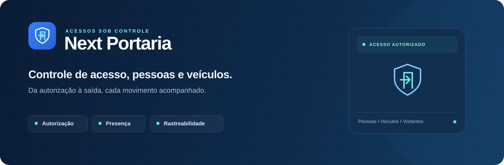
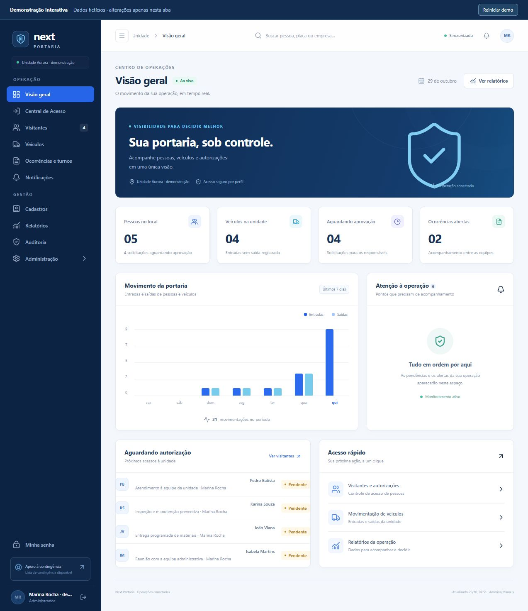
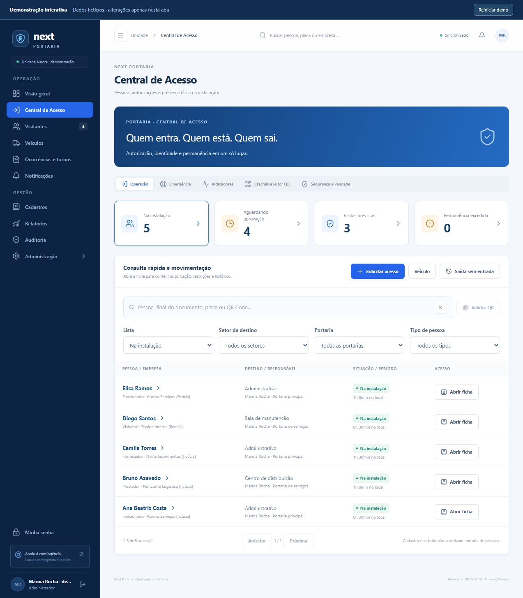
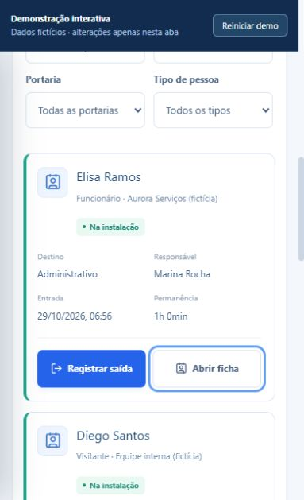

# Next Portaria



[](https://github.com/vinicius-cyber-debug/Next-Portaria/actions/workflows/quality.yml)

**Saiba quem pode entrar, quem está no local e quem já saiu.**

O Next Portaria reúne autorizações, pessoas, visitantes e veículos em uma operação com responsáveis definidos, conferência de identidade e histórico. A equipe acompanha o movimento pelo computador ou celular, com permissões por perfil.

A versão `0.7.0` usa **PostgreSQL 17**, arquivos privados fora do código e envio de fotos e vídeos com retomada nas ocorrências. Consulte [PostgreSQL e recuperação](docs/POSTGRESQL.md), [vídeos e retenção](docs/MIDIAS.md) e [implantação no Windows Server](docs/IMPLANTACAO-SERVIDOR.md). A demonstração permanece uma referência visual.

[**Abrir demonstração**](https://vinicius-cyber-debug.github.io/Next-Portaria/) · [Estudo de caso](docs/ESTUDO-DE-CASO.md) · [Vídeo de 40s](docs/assets/fluxo-visita.mp4) · [Funcionalidades](#o-que-você-pode-fazer) · [Começar](#comece-por-aqui) · [Documentação](#documentação)

Experimente no navegador, sem instalação ou login, com dados fictícios e alterações apenas na memória da aba.

## O que você pode fazer

| Recurso | Na rotina da equipe |
| --- | --- |
| **Autorizações** | Solicitar visitas, definir responsável e substituto, aprovar, recusar ou revogar o acesso. |
| **Presença na unidade** | Consultar pessoas e veículos presentes, registrar entradas e saídas independentes e identificar permanências excedidas. |
| **Segurança** | Conferir identidade, requisitos e validade; restringir setores e validar crachás com QR Code no servidor. |
| **Ocorrências e turnos** | Registrar incidentes, anexar documentos, acompanhar soluções e transmitir pendências à próxima equipe. |
| **Rastreabilidade** | Consultar histórico, notificações internas, relatórios e auditoria de alterações. |
| **Continuidade** | Conferir pessoas em emergência e manter backups operacionais e cópias completas criptografadas. |

## Veja a operação

### Dashboard



| Central de Acesso | Portaria no celular |
| --- | --- |
|  |  |

As capturas utilizam dados fictícios de demonstração.

## Comece por aqui

Requisitos: **Node.js 22.13+**, npm e Git.

```powershell
git clone https://github.com/vinicius-cyber-debug/Next-Portaria.git
cd Next-Portaria
npm ci
```

### Demonstração local

```powershell
npm run dev:demo
```

Abra `http://localhost:4173`. A demonstração utiliza dados fictícios e abre o dashboard sem cadastro ou login. As alterações ficam apenas na memória; **Reiniciar demo** recarrega os dados iniciais.

### Instalação no Windows

Para implantar no servidor, use [o pacote de implantação identificado](docs/IMPLANTACAO-SERVIDOR.md). Para desenvolvimento neste computador, siga [a preparação do PostgreSQL](docs/POSTGRESQL.md). A configuração privada seleciona o banco utilizado pelos comandos; sem ela, permanece disponível o modo D1/SQLite legado.

Para preparar a instalação com banco persistente e contas individuais:

```powershell
.\ATUALIZAR-PORTO-LOCAL.cmd
```

O atualizador coordena backup, verificações, compilação e migrações locais. Na primeira instalação, solicita o administrador; não existe senha padrão. Depois, cadastre a equipe em **Administração → Usuários**.

No uso diário:

```powershell
.\INICIAR-PORTO-LOCAL.cmd
```

A aplicação PostgreSQL local abre em `http://127.0.0.1:5180`; o modo legado usa `5173`. O computador precisa permanecer ligado. O pacote de servidor configura separadamente HTTPS e execução sem login.

## Documentação

- [Desenvolvimento com banco local](docs/DESENVOLVIMENTO-LOCAL.md) — base persistente, carga fictícia, administrador e ambiente em `127.0.0.1:5180`.
- [PostgreSQL e armazenamento privado](docs/POSTGRESQL.md) — migração, diretórios permanentes, backup conjunto e estrutura para mídias.
- [Implantação no servidor](docs/IMPLANTACAO-SERVIDOR.md) — releases, HTTPS, execução sem login, backup externo e aceite.
- [Fotos e vídeos](docs/MIDIAS.md) — envio com retomada, limites, reprodução e retenção.
- [Diagnóstico da evolução](docs/DIAGNOSTICO-EVOLUCAO.md) — estabilidade PostgreSQL, cobertura e limites verificados.
- [Preparação Control iD](docs/INTEGRACAO-CONTROLID.md) — arquitetura e simulador; conexão real aguarda modelo, firmware e validação em bancada.
- [Operação local](docs/OPERACAO-LOCAL.md) — instalação, usuários, rede, backup e problemas comuns.
- [Estudo de caso](docs/ESTUDO-DE-CASO.md) — participação do autor, desafio de negócio e 154 testes aprovados na validação de 30/10/2026.
- [Arquitetura](docs/ARQUITETURA.md) — módulos, persistência e responsabilidades.
- [Decisões técnicas](docs/DECISOES-TECNICAS.md) — escolhas de persistência, permissões, sincronização e seus limites.
- [Notas das versões](docs/CHANGELOG.md) — PostgreSQL, mídias, implantação e histórico.
- [Roadmap](docs/ROADMAP.md) — recursos disponíveis e prioridades de evolução.

## Tecnologias e desenvolvimento

**React 19 · TypeScript · Vinext/Vite · Tailwind CSS · Node.js · PostgreSQL 17**. O modo legado utiliza Cloudflare Workers, D1/SQLite, R2 e esquema Drizzle.

A instalação operacional usa autenticação local, API integrada e armazenamento privado. Os comandos de desenvolvimento, com as dependências instaladas, são:

```powershell
npm test
npm run check
npm run lint
npm run build
```

O [guia de operação](docs/OPERACAO-LOCAL.md) e a [arquitetura](docs/ARQUITETURA.md) detalham a execução com dados persistentes.

## Escopo atual

A instalação atende uma unidade com múltiplas portarias. Gravações exigem conexão; o histórico é consultado por páginas e as notificações são internas. A câmera de QR no celular exige HTTPS. O backup JSON operacional e o backup completo têm finalidades diferentes, descritas no guia de operação.

Dados, contas, chaves e diretórios de execução ficam fora do versionamento. A base conserva compatibilidade de recuperação com registros antigos; módulos desativados continuam indisponíveis após a restauração.

## Contribuição e segurança

Consulte o [guia de contribuição](CONTRIBUTING.md) para preparar o ambiente, relatar problemas e enviar melhorias. Vulnerabilidades devem seguir a [política de segurança](SECURITY.md).

## Autor e licença

Desenvolvido por **Vinicius Maia**, desenvolvedor Full Stack. [LinkedIn](https://www.linkedin.com/in/viniciusmaia001/).

Distribuído sob a [licença MIT](LICENSE).
