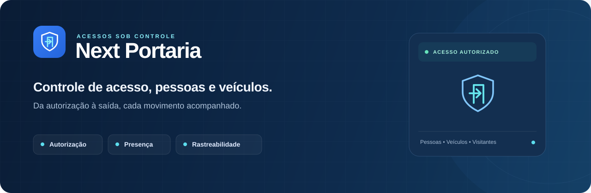
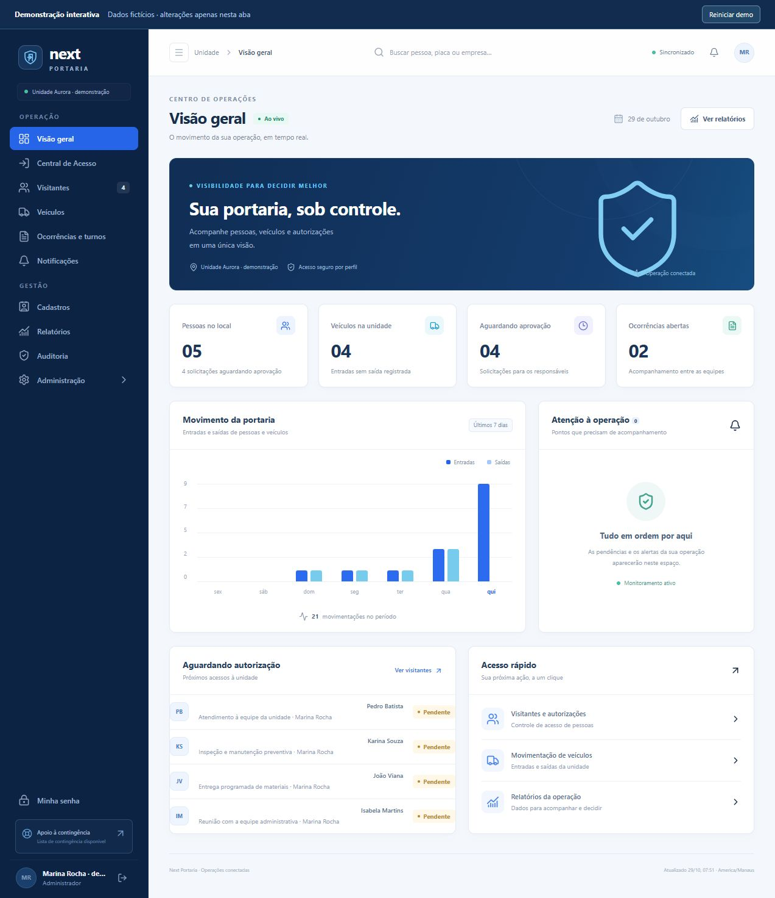
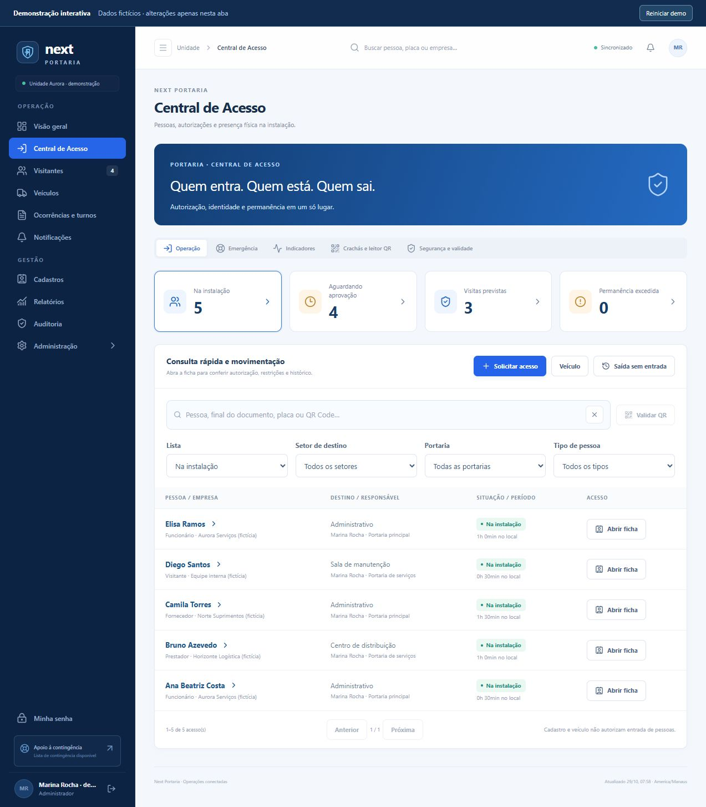
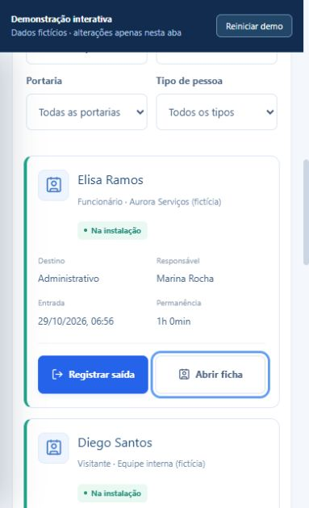

# Next Portaria



[](https://github.com/vinicius-cyber-debug/Next-Portaria/actions/workflows/quality.yml)

**Saiba quem pode entrar, quem está no local e quem já saiu.**

O Next Portaria reúne autorizações, pessoas, visitantes e veículos em uma operação com responsáveis definidos, conferência de identidade e histórico. A equipe acompanha o movimento pelo computador ou celular, com permissões por perfil.

[**Abrir demonstração**](https://vinicius-cyber-debug.github.io/Next-Portaria/) · [Funcionalidades](#o-que-você-pode-fazer) · [Começar](#comece-por-aqui) · [Documentação](#documentação)

Experimente no navegador, sem instalação ou login, com dados fictícios e alterações apenas na memória da aba.

## O que você pode fazer

| Recurso | Na rotina da equipe |
| --- | --- |
| **Autorizações** | Solicitar visitas, definir responsável e substituto, aprovar, recusar ou revogar o acesso. |
| **Presença na unidade** | Consultar pessoas e veículos presentes, registrar entradas e saídas independentes e identificar permanências excedidas. |
| **Segurança** | Conferir identidade, requisitos e validade; restringir setores e validar crachás com QR Code no servidor. |
| **Ocorrências e turnos** | Registrar incidentes, anexar documentos, acompanhar soluções e transmitir pendências à próxima equipe. |
| **Rastreabilidade** | Consultar histórico, notificações internas, relatórios e auditoria de alterações. |
| **Continuidade** | Conferir pessoas em emergência e manter backups operacionais e cópias completas criptografadas. |

## Veja a operação

### Dashboard



| Central de Acesso | Portaria no celular |
| --- | --- |
|  |  |

As capturas utilizam dados fictícios de demonstração.

## Comece por aqui

Requisitos: **Node.js 22.13+**, npm e Git.

```powershell
git clone https://github.com/vinicius-cyber-debug/Next-Portaria.git
cd Next-Portaria
npm ci
```

### Demonstração local

```powershell
npm run dev:demo
```

Abra `http://localhost:4173`. A demonstração utiliza dados fictícios e abre o dashboard sem cadastro ou login. As alterações ficam apenas na memória; **Reiniciar demo** recarrega os dados iniciais.

### Instalação no Windows

Para preparar a instalação com banco persistente e contas individuais:

```powershell
.\ATUALIZAR-PORTO-LOCAL.cmd
```

O atualizador coordena backup, verificações, compilação e migrações locais. Na primeira instalação, solicita o administrador; não existe senha padrão. Depois, cadastre a equipe em **Administração → Usuários**.

No uso diário:

```powershell
.\INICIAR-PORTO-LOCAL.cmd
```

A aplicação abre em `http://127.0.0.1:5173`. O computador servidor precisa permanecer ligado. Consulte o [guia de operação local](docs/OPERACAO-LOCAL.md) para autenticação, início automático, HTTPS e recuperação.

## Documentação

- [Operação local](docs/OPERACAO-LOCAL.md) — instalação, usuários, rede, backup e problemas comuns.
- [Arquitetura](docs/ARQUITETURA.md) — módulos, persistência e responsabilidades.
- [Notas da versão](docs/CHANGELOG.md) — funcionalidades da v0.5.0.
- [Roadmap](docs/ROADMAP.md) — recursos disponíveis e prioridades de evolução.

## Tecnologias e desenvolvimento

**React 19 · TypeScript · Vinext/Vite · Tailwind CSS · Cloudflare Workers · D1/SQLite · R2 · Drizzle**

A instalação operacional usa autenticação local, API integrada e armazenamento privado. Os comandos de desenvolvimento, com as dependências instaladas, são:

```powershell
npm test
npm run check
npm run lint
npm run build
```

O [guia de operação](docs/OPERACAO-LOCAL.md) e a [arquitetura](docs/ARQUITETURA.md) detalham a execução com dados persistentes.

## Escopo atual

A instalação atende uma unidade com múltiplas portarias. Gravações exigem conexão; o histórico é consultado por páginas e as notificações são internas. A câmera de QR no celular exige HTTPS. O backup JSON operacional e o backup completo têm finalidades diferentes, descritas no guia de operação.

Dados, contas, chaves e diretórios de execução ficam fora do versionamento. A base conserva compatibilidade de recuperação com registros antigos; módulos desativados continuam indisponíveis após a restauração.
