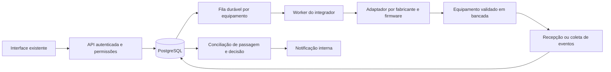

# Integrador de controle de acesso — arquitetura proposta

Atualização de 9/11/2026: o leitor da central **iDSecure** consulta cadastros e fotos em modo somente leitura. A Visão geral também exibe [eventos recentes do monitor](MONITOR-CATRACAS.md), com atualização automática e sem conciliação de passagem física. Veja [operação e configuração](ACESSOS-RECORRENTES-IDSECURE.md). Os contratos abaixo continuam sendo a preparação para eventos de passagem e equipamentos físicos, ainda dependentes de modelos/firmwares. Não há callbacks expostos, escrita remota, biometria ou comando de liberação.

## Fronteira já preparada

`lib/integrations/contracts.ts` define o contrato interno de **consulta**, separado dos formatos HTTP do fabricante. `simulator.ts` trabalha somente com fixtures na memória. `controlid-preparation.ts` registra as referências oficiais e a pendência de validação. Esses módulos não foram ligados à aplicação, ao banco ou ao iniciador do servidor.

```powershell
npm run integration:simulate
node --experimental-strip-types --test tests/integration-preparation.test.mjs
```

A saída identifica `simulation` e `hardwareConnected: false`. O simulador consulta informações, usuários e eventos fictícios; exercita paginação, cursor após reinício, indisponibilidade, timeout, autenticação recusada e cancelamento. Sua retomada usa fixtures iguais; **não implementa fila durável em PostgreSQL**. As capacidades reportadas têm evidência `simulation` e não comprovam suporte de um modelo real.

IDs externos são strings, inclusive inteiros de 64 bits. Autorização concedida, autorização negada, passagem confirmada e desistência são eventos distintos. O identificador de deduplicação considera equipamento, geração, ID, versão e conteúdo normalizado; uma atualização do mesmo log não é descartada como mera repetição.

## Fluxo proposto para as próximas fases



Este desenho é uma proposta. A API operacional atual não passa a comandar equipamentos pela existência desse documento. Um worker separado evita que uma catraca lenta bloqueie o atendimento e permite reinício independente da interface.

## Primeiro passo com Control iD: somente leitura

As fontes abaixo foram consultadas na documentação oficial da **linha de acesso**, não na API de REP/ponto:

| Consulta documentada | Referência | Validação ainda necessária |
| --- | --- | --- |
| Sessão: `POST /login.fcgi` | [Sessão](https://www.controlid.com.br/docs/access-api-pt/gerenciamento-secao/fazer-login/) | Credencial privada, reutilização/expiração da sessão, autorização para consultar a bancada. Sem senha padrão no aplicativo. |
| Informações: `POST /system_information.fcgi` | [Informações do sistema](https://www.controlid.com.br/docs/access-api-pt/sistema/obter-informacoes-do-sistema/) | Modelo, firmware, série, modo, licença e transporte protegido no equipamento real. Não substituir pelo endpoint homônimo de outra linha de produtos. |
| Objetos: `POST /load_objects.fcgi` | [Carregar objetos](https://www.controlid.com.br/docs/access-api-pt/objetos/carregar-objetos/) | Objetos/campos disponíveis, filtros, paginação e ordenação nesse firmware. Projetar campos explícitos para não coletar senhas, hashes ou biometria junto dos usuários. |

Esses nomes são referências documentais, não chamadas implementadas nem declaração de compatibilidade. O contrato interno `readUsers`/`readEvents` precisará de um mapeamento validado. Não adicionar testes automatizados que recebam IP ou credencial real por configuração implícita.

Para iDBlock Next, a documentação descreve componentes primários/secundários e integração através do primário. Alterar `catra_role` pode reiniciar e limpar informações do conjunto; o integrador **não deverá mudar esse papel automaticamente**. Confirmar a topologia existente em bancada. [Particularidades oficiais](https://www.controlid.com.br/docs/access-api-pt/particularidade-dos-produtos/idblock-next/).

O Monitor e os modos online têm finalidades diferentes. O recebimento de um evento não é autorização para comandar um relé. Giro, desistência e alterações de log precisam de conciliação; um log de acesso autorizado, sozinho, não comprova passagem física. [Introdução](https://www.controlid.com.br/docs/access-api-pt/), [Monitor](https://www.controlid.com.br/docs/access-api-pt/monitor/introducao-ao-monitor/).

## Segurança da comunicação

- Autorizar configuração/consulta no servidor, inicialmente para administrador; leitura de eventos pessoais também exige permissão de documentos. Não confiar em perfil recebido do frontend.
- Cadastrar destinos explicitamente, com endereço e rede permitidos, proteção contra SSRF/redirecionamentos e identidade esperada do equipamento. Não realizar descoberta por varredura da rede.
- Exigir TLS validado quando suportado. Se o firmware só oferecer transporte legado, a decisão sobre rede isolada/gateway deve ser explícita antes de habilitar a conexão; não desativar verificação de certificados para fazer um teste passar.
- Guardar no PostgreSQL somente referência do segredo. Credencial e chave ficam fora do Git e fora do acesso comum da interface; o worker recebe o mínimo necessário. Sessões de dispositivo não são sessões dos usuários do Next Portaria.
- Nunca registrar senha, sessão em query string, código de nuvem, template facial ou payload biométrico em logs. Coletar apenas campos aprovados, com limite de resposta, timeout e cancelamento.
- Um callback precisa de identidade de origem validada conforme as capacidades reais do firmware/gateway. Não presumir HMAC ou autenticação de callbacks que o fabricante não documentou. IP declarado no JSON não autentica equipamento.

## Modelo PostgreSQL proposto

As migrações atuais `001`–`003` permanecem intactas. Nenhuma migração operacional nova foi criada/aplicada nesta preparação. As próximas migrações devem ser aditivas, verificadas em banco isolado e precedidas de backup recuperado para verificar antes de alterar uma instalação usada.

| Entidade proposta | Relações e restrições principais |
| --- | --- |
| Pontos de acesso | Unidade, portaria, setor e direção; FK composta para setor em `operational_records('accessAreas', id)`. |
| Dispositivos | UUID interno, fabricante/modelo/firmware, série, ponto, primário do conjunto, configuração habilitada e geração do equipamento; estado de conectividade separado do estado de sincronização. |
| Configuração do integrador | Referência do segredo, transporte, evidência de bancada e capacidades verificadas por firmware; sem biometria ou senha em JSON público. |
| Vínculos de identidade | Pessoa em `operational_records('people', id)` e ID externo em texto; unicidade por equipamento e geração. |
| Estado desejado de autorização | Pessoa, ponto, validade e geração monotônica de política; concessão e revogação auditadas. |
| Fila de sincronização/outbox | Criada na mesma transação da autorização/revogação; chave idempotente, ordem por equipamento, tentativas, lease e próxima tentativa. |
| Tentativas de sincronização | Resultado sanitizado, duração, código, comando e evidência de consulta posterior; sem resposta bruta contendo dados pessoais. |
| Inbox/eventos físicos | Chave de deduplicação única por equipamento/geração/versão; preservar atualização de log, instante do equipamento e recebimento pelo servidor. |
| Cursor de coleta | Posição confirmada somente junto da gravação dos eventos; reinício não perde nem confirma antecipadamente uma página. |
| Decisões e conciliação | Resultado, motivos, revisão da política, vínculo com autorização/pessoa e evidência física; decisão permitida não cria presença automaticamente. |
| Notificações | Reaproveitar avisos internos, com novos tipos e destinatários; deduplicação e estado de leitura. Não criar um segundo cadastro de destinatários. |

Índices devem atender equipamento/estado/próxima tentativa, pessoa/ponto/validade e equipamento/instante. Eventos podem ter retenção própria, com limpeza auditada em lotes; auditoria e decisões devem seguir política específica da empresa. Uma política não deve apagar registros necessários para conciliação pendente. Não definir prazo legal universal nem coletar faces por conveniência.

## Ordem, revogação e falhas

O worker deve reservar trabalhos com lease e `FOR UPDATE SKIP LOCKED`, mantendo ordem por equipamento. Backoff exponencial limitado, com jitter e limite de tentativas, serve para consultas e falhas recuperáveis. Credencial recusada exige correção, não tentativas infinitas. Para escrita incerta, consultar o estado real antes de repetir; a API não deve repetir cegamente uma operação física.

Cada comando leva a geração da política. Uma concessão antiga, ainda na fila ou em retentativa, deve ser invalidada por uma revogação mais nova. Receber HTTP 200 do dispositivo não basta para declarar sincronização: confirmar estado e registrar evidência. Após reinício, comparar identidade/geração do equipamento e reconciliar antes de considerar o estado fresco.

O servidor não consegue garantir revogação imediata em um dispositivo autônomo desconectado que conserva permissões locais. Esse comportamento precisa ser validado fisicamente. Sem capacidade comprovada de recusa segura/expiração e política de contingência aprovada, não habilitar sincronização de concessões. Estado desconhecido, equipamento offline ou política não confirmada devem aparecer como indisponíveis, sem apresentar autorização antiga como atual. A contingência manual exige justificativa, operador e auditoria; não é uma liberação automática.

## Motor de regras, portal e notificações

Reutilizar `assertVisitEligibility`, requisitos por pessoa/setor e as regras de entrada de `physical-access.mjs`; não copiar essas regras para o adaptador ou para o frontend. A decisão futura deve carregar dados atuais no servidor, considerar identidade/cadastro, autorização, validade, setor, categoria, requisitos e revogação, e gravar motivos e versão. Conferência manual de documento não pode ser inferida de um evento facial sem um processo de identidade definido e validado.

O fluxo atual de solicitação antecipada é autenticado. Um portal externo futuro precisa de convite opaco aleatório, armazenamento do hash, escopo mínimo, expiração, uso/revogação e limitação de requisições. Não colocar documento, nome ou ID sequencial em link público. Não criar um perfil de solicitante que herde poderes de administrador ou portaria.

Priorizar os avisos internos existentes. Fila/outbox para canais externos é uma fase posterior; WhatsApp só por provedor oficial e configuração privada, com consentimento e controle de entrega/deduplicação. Nenhuma mensagem externa é enviada por esta preparação.

## Próxima etapa e aceite

1. Registrar modelos exatos, firmwares, série, topologia primário/secundário, modo e licença. Não atualizar firmware nem reconfigurar equipamentos para obter essas informações.
2. Conferir a documentação correspondente e fechar o esquema relacional/retention antes de criar a próxima migração.
3. Com autorização para bancada, validar somente autenticação, informações e páginas de leitura; guardar evidências sanitizadas por versão.
4. Só então projetar escrita controlada, biometria e regras com aprovação explícita. Testes de liberação física são manuais e separados dos testes automatizados.

Nenhuma das fases futuras é declarada implementada ou validada por um teste do simulador.
